# How to use Lending Ops

This guide is for anyone who wants to run the demo and click around: no programming knowledge needed. It covers:

1. [What this is](#1-what-this-is), in plain words
2. [Setting it up](#2-set-it-up-about-5-minutes) (about 5 minutes, two commands)
3. [A 10-minute tour](#3-a-10-minute-tour), for showing it to someone
4. [Every page explained](#4-every-page-explained), with screenshots
5. [Creating test applications](#5-creating-test-applications-synthesize)
6. [How everything is connected](#6-how-everything-is-connected)
7. [Stopping, resetting and fixing problems](#7-stopping-resetting-and-troubleshooting)

For the engineering design, see the [README](README.md). Unfamiliar words are defined in the [glossary](docs/glossary.md).

---

## 1. What this is

A lender gets loan applications from three places: its website (the **portal**), **brokers** who send emails, and **aggregators** (comparison sites that send batches of applications in a file). Each application has to go through the same steps before any money moves:

> check the form → check the applicant with outside services (credit score, identity, fraud) → decide using the product's rules → sometimes ask a person to review → get the agreement signed → send the money

Every application ends in exactly one of three outcomes:

| Outcome | Meaning |
|---|---|
| **Funded** | Approved, signed and paid out. This is the only outcome the lender can bill for. |
| **Declined** | Turned down: by the rules, by a reviewer, or because the applicant withdrew or never responded. |
| **Escalated** | Something went wrong that a person in operations has to handle (for example, the bank rejected the payment). |

The system runs on **Temporal**, a tool that makes long, multi-step processes reliable. If a computer restarts or an outside service goes down halfway through, the application picks up exactly where it left off. Nothing is lost and nothing happens twice (no one is paid twice).

**Lending Ops** is the web page (the "ops console") where you watch applications move, act as a reviewer, and see reports. Everything in it is simulated: the applicants, the credit bureau, the bank. No real data or money is involved.

---

## 2. Set it up (about 5 minutes)

### What you need

- A Mac, Windows or Linux computer.
- **Node.js version 20 or newer.** If you don't have it, download the "LTS" version from [nodejs.org](https://nodejs.org) and install it like any other app. To check, open a terminal and type `node --version`; you should see `v20` or higher.
- This project's folder on your computer: download it from GitHub (**Code → Download ZIP**, then unzip it) or `git clone` it.

You do **not** need to install Temporal, Docker or a database. The project downloads and starts what it needs.

### Start it

Open a terminal **in the project folder**. (On a Mac: open Terminal, type `cd `, a space, drag the folder into the window, then press Enter.) Then run these two commands, one at a time:

```bash
npm install
```

This downloads the project's building blocks. It takes a minute or two and only needs doing once.

```bash
npm run demo
```

This starts everything and loads 20 example applications, so there is something to look at straight away. The first time, it also downloads the Temporal engine (about a minute). When it's ready, you'll see:

```text
  Ready.

    Ops console   http://localhost:3000      ← open this
    Temporal UI   http://localhost:8233      (the engine underneath, optional)
```

**Open http://localhost:3000 in your browser.** That's it.

> **Tip:** use `npm start` instead of `npm run demo` to start with an empty console.
>
> Leave the terminal window open while you use the demo; closing it stops everything. Press **Ctrl+C** in it to stop.

---

## 3. A 10-minute tour

If you're showing this to someone, this order tells the story:

1. **Flow** (the home page): "Here is every application and where it went." Point at the wide bands flowing into **Funded**, **Declined** and **Escalated**.
2. Click **Synthesize many…**, choose **Scenario pack → SLA pressure**, then **Start run**. Within about a minute, the **SLA watch** tab fills with applications that are late or about to be late.
3. **SLA watch**: "These are the ones a manager should worry about, the most urgent first."
4. Click a card in the **Breached** column, then **Claim** it and **Approve** it. "A person's decision is part of the process. The claim stops two reviewers from deciding the same case."
5. **Cases**: click any **Funded** row: "This is the full history of one application, including who approved it and what we billed."
6. **Health**: switch the **fraud** provider off, pick **Fraud signals** in the scenario box, click **Synthesize**, and watch it wait (**Awaiting provider**) rather than fail. Switch fraud back on and it carries on by itself.
7. **Billing** and **Audit**: "Every funded loan is billed exactly once, and every decision is recorded and can be exported for compliance."

---

## 4. Every page explained

The bar at the top is on every page. The tabs on the left switch pages; the buttons on the right create or clear test data (see [section 5](#5-creating-test-applications-synthesize)). A number on a tab (like **Review queue 5**) means that many items are waiting for someone.

### Flow: the big picture

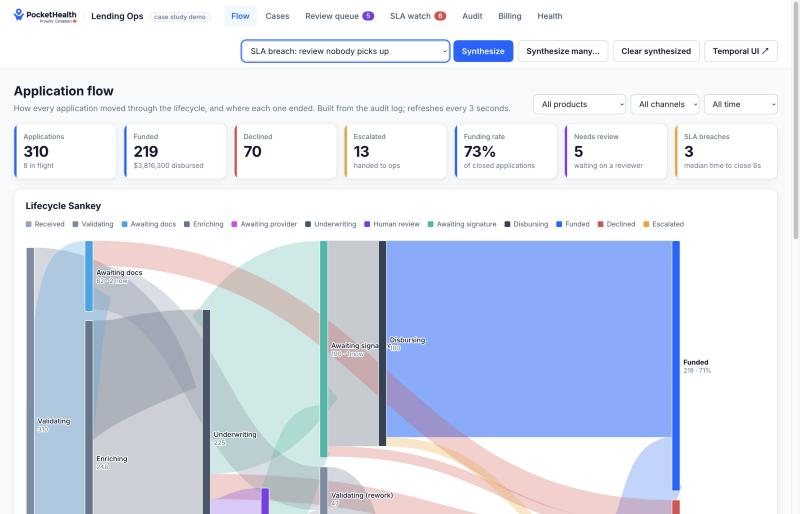

- **The tiles** across the top are totals: how many applications, how many funded, the funding rate, how many need a reviewer, and how many missed their deadline (**SLA breaches**).
- **The diagram** (a "Sankey") shows the journey. Each column is a step; the thickness of each band is how many applications took that path. Bands ending on the right are final outcomes. Hover over a band to see the numbers.
- **The filters** (top right) narrow it to one product (Personal, Auto, Debt consolidation), one channel, or a time window.
- Further down are the **State machine** (the official list of steps, with how many applications are at each one now) and **Why applications ended** (the reasons behind each outcome).

### Cases: every application

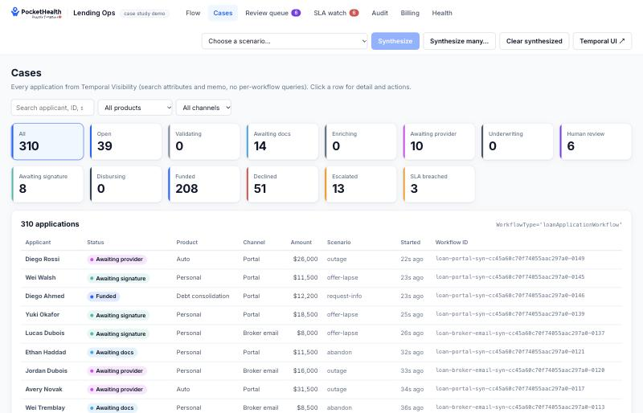

- **The coloured tiles** count applications by their current step. **Click a tile** to show only those, for example **Awaiting docs** or **Human review**.
- **The search box** finds an applicant by name or ID.
- **Click any row** to open that application's details:

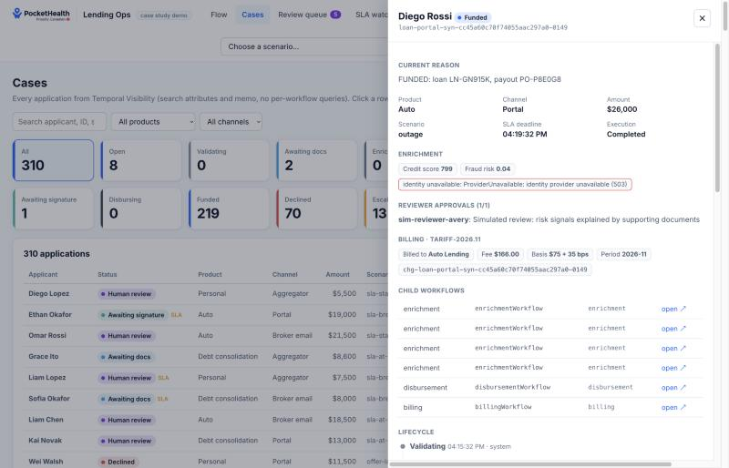

The details panel shows everything about one application: why it is in its current state, the credit and fraud results, who approved it, what was billed, and every step with a timestamp (**Lifecycle**). The **open ↗** links show the same application inside Temporal (optional; for engineers). **Download audit PDF** gives a report of the case.

If the application is waiting on someone, the panel offers the action for that wait, standing in for the applicant: **Mark … uploaded** for missing documents, **Simulate "signed" webhook** for the agreement, or the reviewer's decision.

### Review queue: decisions for a person

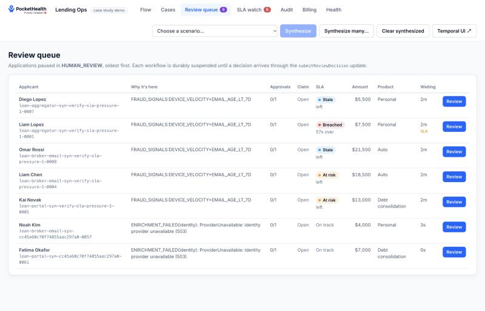

Some applications need a person: a fraud signal, a large loan, or an outside service that stayed down. They wait here, oldest first. **Why it's here** gives the reason. **SLA** shows how much time is left. **Approvals 0/2** means the loan is large enough to need two different people to approve it ("four-eyes").

Click **Review** to open one:

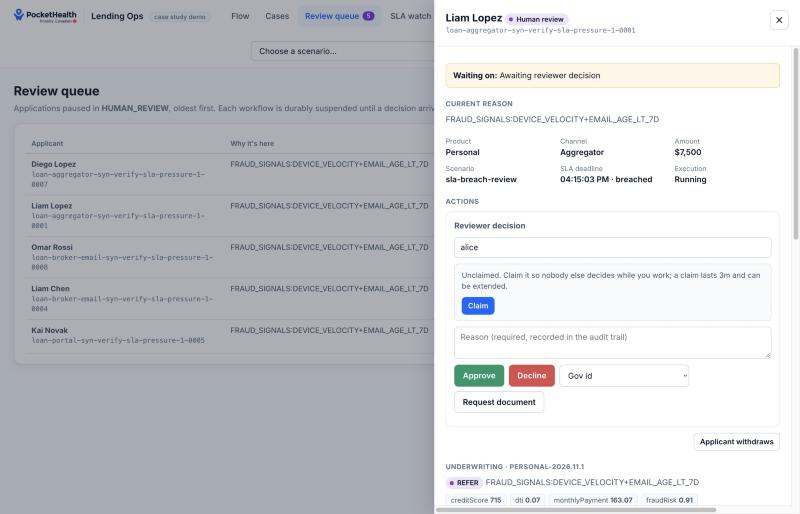

1. Type your name in the box at the top (it starts as *alice*).
2. Click **Claim**. This reserves the case for you, so nobody else decides it while you read.

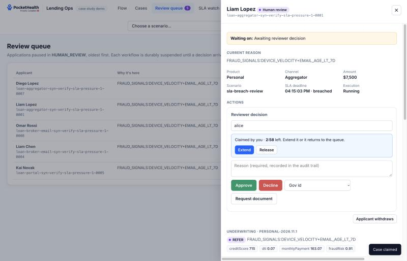

3. A **countdown** starts (3 minutes in the demo). This works like a website session that times out: if you walk away, the case goes back to the queue for someone else, and you get a reminder shortly before. Click **Extend** for more time, or **Release** to hand it back.
4. Write a **reason** (required; it goes into the permanent record), then click **Approve**, **Decline**, or **Request document** to ask the applicant for something else.

Your decision takes effect immediately. If you click twice by accident, it still only counts once.

### SLA watch: what's late or about to be

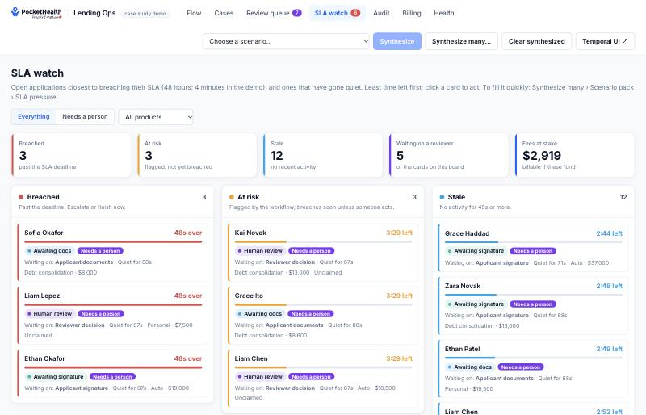

An **SLA** (service level agreement) is the promised deadline: every application should be finished within 48 hours (shortened to 4 minutes in the demo, so you can see it happen). This board shows the open applications a manager should look at:

| Column | Meaning |
|---|---|
| **Breached** (red) | The deadline has passed. Act now. |
| **At risk** (orange) | Close to the deadline. It breaches soon unless someone acts. |
| **Stale** (blue) | Plenty of time left, but nothing has happened for a while. Someone may have forgotten it. |

Each card shows how much time is left (or how far over it is), what the application is **waiting on** (a reviewer, the applicant's documents, a signature), how long it's been quiet, and the loan amount. **Click a card** to open it and act. **Needs a person** at the top narrows the board to the ones a person can unblock. **Fees at stake** is what the lender would earn if they all fund.

> **To fill this board for a demo**, use the **SLA pressure** pack: **Synthesize many… → Scenario pack → SLA pressure → Start run**. Within about a minute you'll have 3 breached, 3 at risk and 2 stale applications (they use a shortened clock so you don't have to wait).

### Audit: the permanent record

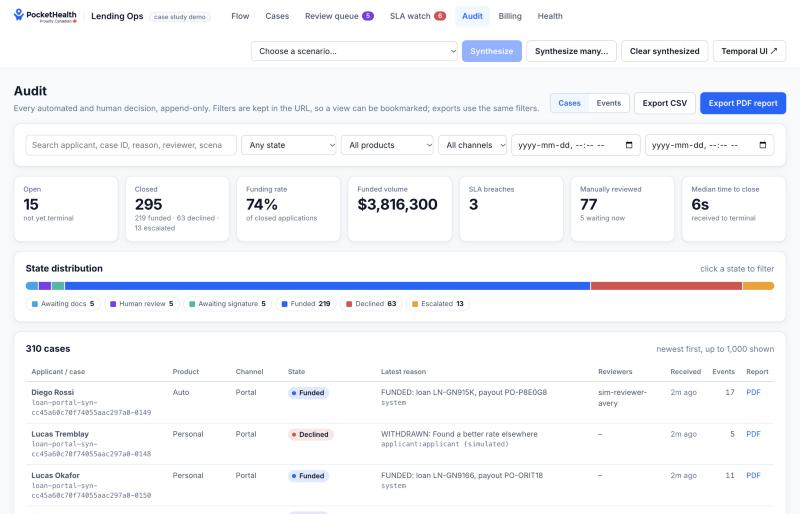

Every decision, whether made automatically or by a person, is written to a log that is only ever added to, never edited. This page is the view a compliance team would use.

- **Cases / Events** (top right) switches between one row per application and one row per individual event.
- **The filters** narrow it by state, product, channel, date, or a search (for example a reviewer's name). The filters are kept in the page address, so you can bookmark a view.
- **Export CSV** downloads the table for Excel. **Export PDF report** downloads a formatted report of exactly what's on screen. Each row's **PDF** link gives a one-case report.
- **Click a state** in the coloured bar to filter to it.

### Billing: what the lender charges

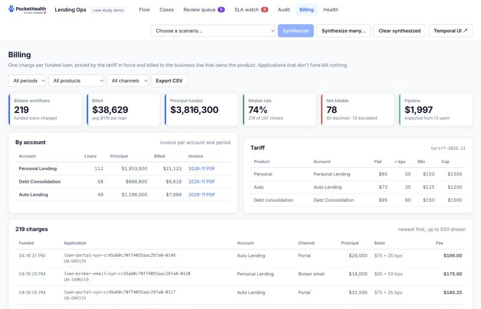

Each **funded** loan is billable: the lender charges the business line that owns the product. Declined and escalated applications cost nothing. The fee is a flat amount plus a small percentage of the loan, with a minimum and a maximum (the **Tariff** table; the numbers are illustrative).

- **The tiles** show how many loans were billed, the total, the share of finished applications that were billable, and the **Pipeline** (expected fees from applications still open).
- **By account** totals each business line. The **PDF** link is a ready-made monthly invoice.
- **Charges** lists every fee. Each loan is billed exactly once, even if something is retried.
- **Export CSV** downloads the charges.

### Health: outside services and outages

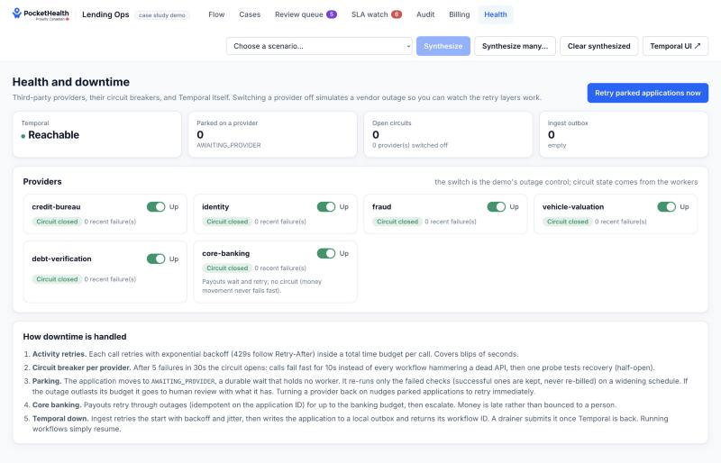

The system relies on outside services (a credit bureau, an identity check, a fraud check, the bank). In real life these go down. This page lets you **simulate an outage**:

1. Switch a provider **off** (for example *fraud*).
2. Start a few applications (for example the **Happy path** scenario, several times).
3. Watch them move to **Awaiting provider**: they wait patiently instead of failing. After a few failures the provider's **circuit** opens, so the system stops calling a service it knows is down.
4. Switch it back **on**. The waiting applications resume by themselves. **Retry parked applications now** nudges them immediately.

If an outage lasts too long, the application is handed to a person in the Review queue rather than waiting forever. Switching off **core-banking** shows that payouts wait and retry, and nobody is ever paid twice.

### Temporal UI (optional, for engineers)

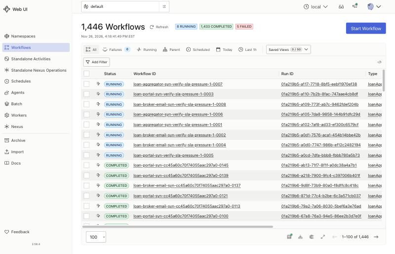

The **Temporal UI ↗** button opens the engine's own dashboard (http://localhost:8233). Each application is a "workflow" there, with its step-by-step history. You don't need it to use the demo; it shows what's happening underneath.

---

## 5. Creating test applications ("Synthesize")

"Synthesize" means "create test applications". There are no real applicants, so the demo makes them up, each designed to follow a particular path.

### One at a time

1. Pick a story from **Choose a scenario…** in the top bar (for example *Fraud signals* or *SLA breach: review nobody picks up*). Choosing alone does nothing.
2. Click **Synthesize**. One application starts and a message confirms it.

Some useful scenarios:

| Scenario | What happens |
|---|---|
| Happy path | Funded in about a second. |
| Fraud signals | Waits in the **Review queue** for you to approve or decline. |
| Large loan (four-eyes) | Needs **two different** reviewers to approve. |
| Missing paystub | Waits for documents. Open the case and click **Mark Paystub uploaded**. |
| Waits for signature | Approved, waits for the applicant to sign. Open it and click **Simulate "signed" webhook**. |
| Credit bureau down ~20s | Waits out a short outage, then funds by itself. |
| Payout rejected | The bank refuses the payment, so it's **Escalated**. |
| SLA breach / SLA at risk / SLA going stale | Shows up on the **SLA watch** board within a minute. |

The list in the app has every scenario with a one-line description.

### Many at once

Click **Synthesize many…**. There are two ways:

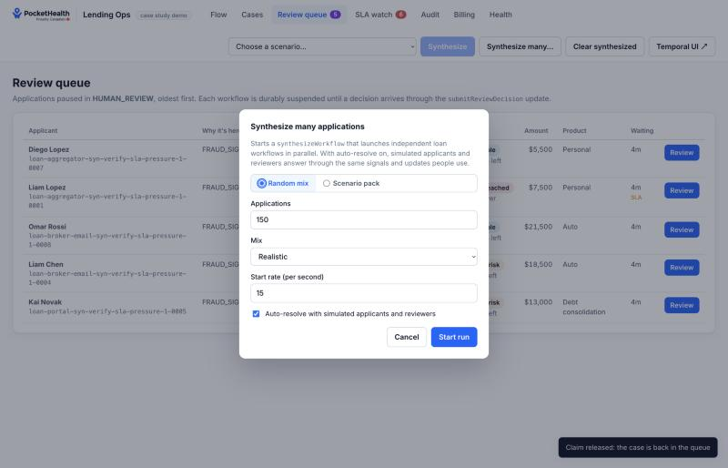

**Random mix** creates lots of applications (for example 150) with a realistic spread of outcomes. Use it to fill the Flow diagram and reports. **Stress** has more failures and outages. Leave **Auto-resolve** ticked and simulated applicants and reviewers respond by themselves; untick it and everything that needs a person waits for you.

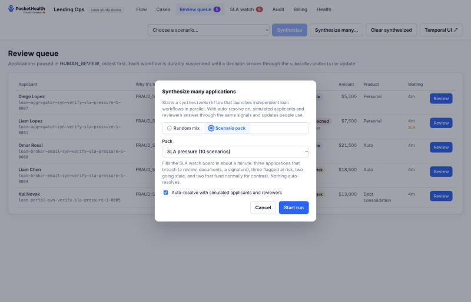

**Scenario pack** creates a fixed, hand-picked set:

| Pack | Use it to |
|---|---|
| **Showcase: every path** (20) | See every kind of outcome at once. Three are left for you to handle (a review, a document upload, a signature). This is what `npm run demo` loads. |
| **SLA pressure** (10) | Fill the **SLA watch** board: 3 breach, 3 at risk, 2 go stale, and 2 fund normally for contrast. Ready in about a minute. |

### Clearing it all

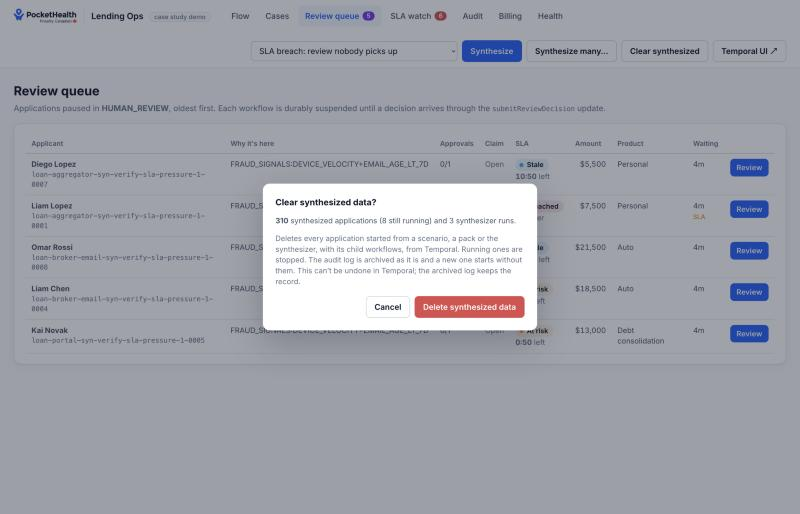

**Clear synthesized** removes every test application so you can start fresh. It tells you exactly what it will delete and asks before doing anything. The audit and billing records aren't erased: they're archived to a file and a fresh log starts, because a real audit trail is never deleted.

---

## 6. How everything is connected

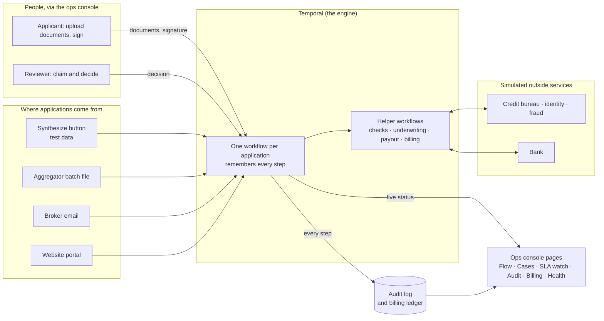

In words:

1. **An application arrives** from one of the three channels, or from the **Synthesize** button in the demo. Temporal starts a **workflow** for it: a process that remembers exactly where it is, even through restarts. The same application arriving twice still gets only one workflow.
2. **The workflow does the steps in order.** The automatic stages (checking with outside services, applying the product's rules, paying out, billing) are each done by a helper workflow, so a problem in one area can't break another.
3. **When it needs a person**, it pauses and waits without using any resources, for hours or days if need be. The reviewer's decision, the applicant's documents and the signature all come in through the ops console.
4. **When an outside service is down**, the workflow waits and retries rather than failing (see **Health**).
5. **Every step is written to the audit log** and every funded loan to the billing ledger. The **Flow**, **Audit** and **Billing** pages read from these. **Cases**, **Review queue** and **SLA watch** ask Temporal for the live state.
6. **A deadline timer** runs alongside every application. It flags **At risk**, then **Breached**, on the SLA watch board. It alerts people but never cancels the application.

The [diagrams page](docs/diagrams.md) has the detailed engineering version of this picture.

---

## 7. Stopping, resetting and troubleshooting

| I want to… | Do this |
|---|---|
| Stop everything | Press **Ctrl+C** in the terminal where it's running. |
| Start again | `npm start` (empty) or `npm run demo` (with the 20 examples). |
| Remove all test data | Click **Clear synthesized** in the console. |
| Run the automated tests | `npm test` (takes a few minutes; it starts its own private engine). |

Applications live in Temporal's memory, so stopping the demo forgets them. The audit and billing logs are files in the `audit/` folder and are kept between runs. Click **Clear synthesized** after a restart if you want the reports to start from zero too.

**Common problems**

| Message or symptom | Fix |
|---|---|
| `Node 20 or newer is needed` | Install the LTS version from [nodejs.org](https://nodejs.org), open a new terminal, and try again. |
| `Port 3000 … is already in use` | Another copy is probably still running. Close it (Ctrl+C in its terminal), or run on a different port: `PORT=3001 npm start` (and open http://localhost:3001). The same goes for `TEMPORAL_PORT` and `TEMPORAL_UI_PORT`. |
| `npm: command not found` | Node.js isn't installed (npm comes with it). See "What you need" above. |
| The first start sits on "Starting the Temporal dev server" | It's downloading the engine the first time; give it a minute. It needs internet access just this once. |
| The page is empty | Click **Synthesize many…** and start a pack, or restart with `npm run demo`. |
| An application seems stuck | Open it from **Cases**: the yellow **Waiting on** box says what it needs. Most "stuck" ones are waiting on a person (a review, documents or a signature), which is by design. |

<details>
<summary>For engineers: running the parts separately</summary>

`npm start` runs the Temporal dev server, the workers and the console in one process. To run them separately (for example, to restart workers while applications are in flight), use one terminal each:

```bash
npm run server   # Temporal dev server on 7233, its UI on 8233
npm run worker   # all workers
npm run ui       # the ops console on 3000
```

Everything in the console can also be done from the command line (`npm run ingest`, `npm run review`, `npm run provider`, and so on). See the [README](README.md#cli).

</details>
