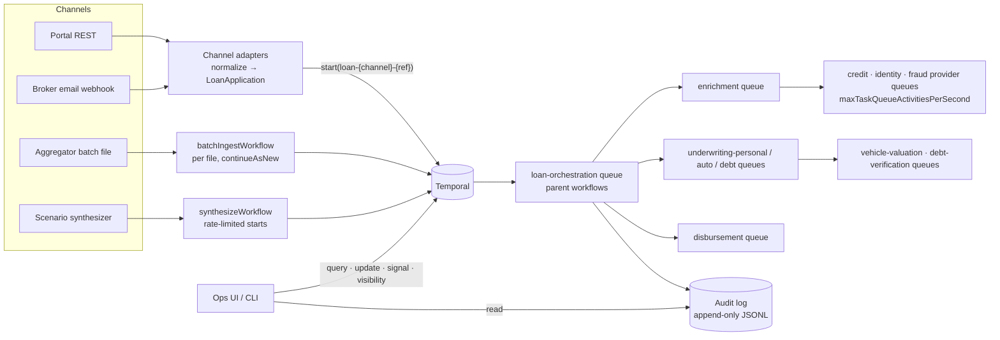
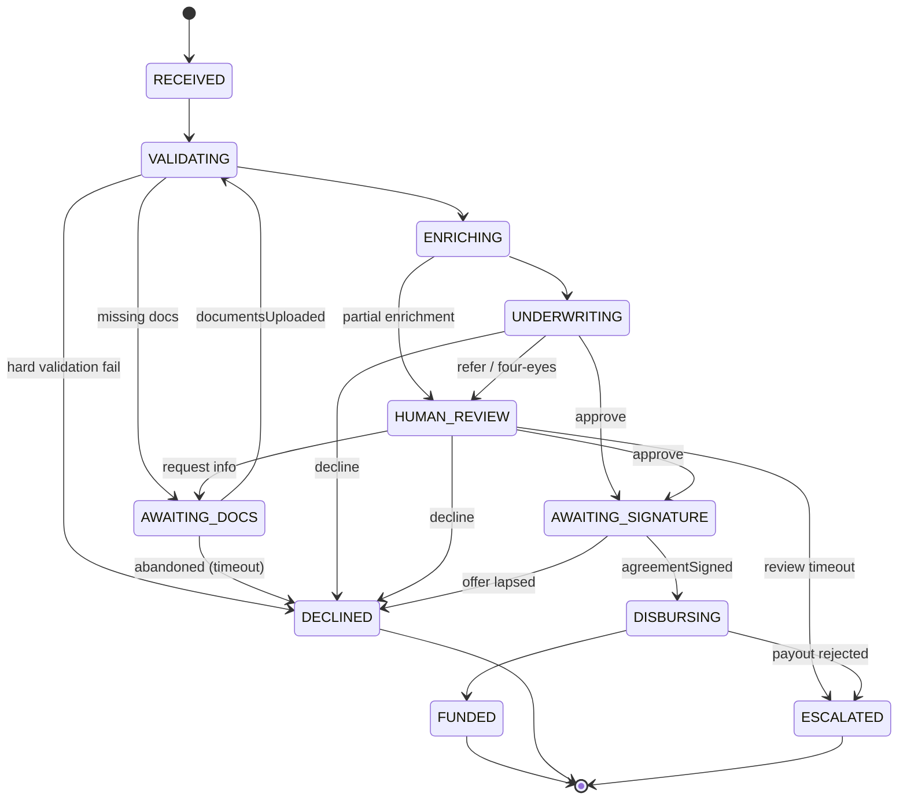

# Plan: Loan Disbursement on Temporal — child workflows at isolation seams

> Orchestration is built around **child workflows at isolation seams**, with a flow (Sankey) view and a scenario synthesizer for demos.
>
> Language: **TypeScript**, Temporal TS SDK. The 2-hour timebox is waived, so this is built to full scope.

## 1. Decisions made

| # | Decision | Choice |
|---|---|---|
| D1 | Child workflow granularity | Children at **isolation seams**: Enrichment, Underwriting (one type per product), Disbursement. Validation stays an activity. |
| D2 | Where interactive waits live | **Only in the parent.** Docs upload, human review, e-signature and withdraw all target the one parent workflow ID. Children are non-interactive: input in, result out. |
| D3 | Ingestion / "master queue" | **Temporal only.** Each application is its own workflow; task queues are the work queues. Channel adapters call `start()` with an idempotent workflow ID. No broker in front, no master workflow. |
| D4 | Reviewer decision | **Update with validator** (sync accept/reject; enforces state, reason, four-eyes). |
| D5 | 48h SLA breach | **Alert, don't cancel.** Specific waits (docs, review, signature) have their own timeouts that decline or escalate. |
| D6 | Scope | Core workflows + tests, CLI, branded ops UI, audit table with exports, scenario synthesizer, flow Sankey with terminal-state counts. |

## 2. Why children here (and not everywhere)

A child workflow earns its cost (extra history events, a little latency, another ID to route) when it buys one of: **reuse across products/clients, a separate task queue/worker deployment, independent versioning, or failure isolation**.

| Child | Reuse | Own queue / deploy | Versioning | Isolation |
|---|---|---|---|---|
| `enrichmentWorkflow` | Same credit/identity/fraud fan-out for every product and any future client; driven by a list of required checks | `enrichment` | Provider changes ship without touching underwriting | A provider outage is contained and returned as a partial result |
| `underwriting<Product>Workflow` ×3 | One per product; new product = new child type + policy | `underwriting-{product}` | Per-product Worker Versioning | A bad auto-loan rules deploy can't affect personal loans |
| `disbursementWorkflow` | Same payout path for all products | `disbursement` | Core-banking integration versions independently | Owned by a payments team; money movement isolated |

Not children: validation (one activity), notifications and audit (activities), human waits (D2).

Reuse across "similar clientele" mostly comes from **parameterization**: `ProductPolicy` decides which checks enrichment runs and which rules underwriting applies. The child boundaries make those pieces deployable and testable on their own.

## 3. Architecture



## 4. Lifecycle state machine



Withdraw (signal) is honoured at every wait and stage boundary → DECLINED(`WITHDRAWN`), never once payout has started. Any child failure that escapes is caught at the top of the parent → ESCALATED with root cause. Code bugs are not caught; they fail the workflow task and Temporal retries until a fix is deployed.

## 5. Workflows and their API

**`loanApplicationWorkflow`** (parent, `loan-orchestration`)
- Owns state, transition history, SLA watchdog timer, search attributes (`ApplicationStatus`, `ProductType`, `Channel`, `SlaBreached`), and audit emission.
- Calls children with deterministic IDs: `${wfId}/enrichment`, `${wfId}/underwriting`, `${wfId}/disbursement`. Re-underwriting after "request info" uses a `-2`, `-3` suffix.
- Signals: `documentsUploaded(docTypes)`, `agreementSigned(envelopeId, signer)`, `withdraw(reason)`.
- Update: `submitReviewDecision({decision, reviewerId, reason})`. Validator rejects: not in HUMAN_REVIEW, missing reason, same reviewer twice when four-eyes applies.
- Query: `getStatus()` returns state, pending action, missing docs, enrichment summary, underwriting outcome, approvals, transition history.

**`enrichmentWorkflow`** (`enrichment`)
- Input: `{applicant, checks: ('credit'|'identity'|'fraud')[]}`. Fans out with `Promise.allSettled` to provider activities, each on its own queue.
- Output: `{results, failures[]}`. Never throws for provider exhaustion; the parent decides (→ HUMAN_REVIEW).

**`personalLoanUnderwriting` / `autoLoanUnderwriting` / `debtConsolidationUnderwriting`** (`underwriting-{product}`)
- Input: application + enrichment results. Runs product-specific extra checks (vehicle valuation for auto, debt verification for debt consolidation), then the `evaluateRules` activity with that product's policy.
- Output: `{decision: APPROVE|DECLINE|REFER, reasons[], metrics, policyVersion, requiresFourEyes}`.

**`disbursementWorkflow`** (`disbursement`)
- Runs after signature: `bookLoan` → `disburseFunds` (idempotency key = parent workflow ID) → `confirmFunding`. Non-retryable payout rejection → returns failure → parent ESCALATES.

**`batchIngestWorkflow`**: per aggregator file. Reads pages through an activity, starts one parent per valid row (`ParentClosePolicy.ABANDON`, same idempotent IDs), rejects bad rows individually, `continueAsNew` every N pages.

**`synthesizeWorkflow`**: takes `{count, mix, ratePerSec, autoResolve}` and starts N applications from scenario profiles at a bounded rate. Demonstrates parallel execution. With `autoResolve`, simulated applicants and reviewers answer docs requests, reviews and signatures after a random delay so terminal states fill in. *(As built: the simulated world reacts to the `notify` activity and answers through the same signals/update a person uses, so no simulation code lives in workflows.)*

## 6. Activities

| Activity | Queue | Timeouts | Retry | Notes |
|---|---|---|---|---|
| `validateApplication` | orchestration | 10s | 3 | Schema + product doc checklist |
| `fetchCreditReport` / `verifyIdentity` / `checkFraud` | per provider | s2c 30s, schedule-to-close 30m (demo: seconds) | backoff 1s→1m | 429 → `ApplicationFailure` with `nextRetryDelay`; `SubjectNotFound` non-retryable |
| `valueVehicle` / `verifyDebts` | per provider | same | same | Product-specific |
| `evaluateRules` | `underwriting-{product}` | 10s | 3 | Rules in activities so threshold changes never break replay |
| `sendEnvelope` | orchestration | 10s | 5 | Deterministic envelope ID |
| `bookLoan` / `disburseFunds` / `confirmFunding` | disbursement | 60s, heartbeat | 5, payout rejection non-retryable | Idempotent on workflow ID |
| `recordAuditEvent` | orchestration | 5s | unlimited | Decision without audit is unacceptable |
| `notify` | orchestration | 10s | 3, then audit `NOTIFICATION_FAILED` | Best effort |

Mock providers read `application.simulate` (flaky N times, outage, fraud hit, payout reject, etc.) to drive failure paths deterministically.

## 7. Product isolation

`ProductPolicy` per product (`src/products/`): `requiredDocs`, `hardLimits`, `enrichmentChecks`, `extraChecks`, `rules()`, `fourEyesThreshold`, `version`. The version is recorded on every decision (`rules:auto-2026.11.1`). Each product has its own child type and queue, so it can be deployed, scaled and versioned alone.

## 8. Human-in-the-loop

- Entry: REFER from rules, four-eyes amount, partial enrichment, request-info loop.
- Pause: `await condition(() => decisionReady || withdrawn, reviewTimeout)`. Durable, zero worker cost, survives restarts.
- Input: `submitReviewDecision` update (D4). The UI shows the validator's rejection inline.
- Resume: code continues after `condition` with full context. REQUEST_INFO → AWAITING_DOCS → re-validate → new enrichment/underwriting children.
- Timeout → ESCALATED + ops notification.
- Same pattern for docs and e-signature waits (signals, with reminder + lapse timers).

## 9. Audit and visibility

- `recordAuditEvent` writes one JSON line per transition and decision: `{ts, workflowId, runId, from, to, actor, reasonCodes, details, policyVersion}`. Actor is `system`, `rules:<version>`, `reviewer:<id>`, `applicant` or `provider:<name>`.
- Temporal history remains the low-level record; the audit log is the business-level one and the source for the Sankey and reports.
- Production notes (doc only): insert-only Postgres or S3 Object Lock, history archival, payload codec for PII.

## 10. UI (Node http server, no build step)

### Branding: PocketHealth

Taken from pockethealth.com (inspected 2026-11-26). Defined once as CSS custom properties in `src/ui/public/brand.css` and mirrored in `src/reports/brand.ts` for the PDFs.

| Token | Value | Use |
|---|---|---|
| `--ph-blue` | `#0066FF` | Primary: buttons, links, active filters, FUNDED flow |
| `--ph-blue-tint` | `#EFF7FF` | Selected rows, info banners |
| `--ph-ink` | `#0F172A` | Headings |
| `--ph-text` | `#475569` | Body text |
| `--ph-muted` | `#64748B` | Secondary text, axis labels |
| `--ph-border` | `#CBD5E1` | Borders; `#E2E8F0` for dividers |
| `--ph-surface` | `#F8FAFC` | Page background; cards white |
| Font | Inter (Google Fonts), Arial fallback | Headings 700, buttons 600, body 400 |
| Shape | 7px radius, 10px button padding, 15px button text | Matches site buttons |

- **Logo:** the full PocketHealth logo SVG (`fulllogo.svg` from the site's theme) saved locally to `src/ui/public/brand/pockethealth-logo.svg` and embedded in the PDF header. Text wordmark fallback if the file is missing.
- **State colours** (Sankey, chips, charts) are derived around the brand blue: FUNDED `#0066FF`, in-flight slate tones, DECLINED a muted red, ESCALATED amber, HUMAN_REVIEW violet. Checked for contrast in light and dark mode.
- Product label in the header: "PocketHealth · Lending Ops (case study demo)", so it reads as a demo, not a real PocketHealth product.

Pages:
1. **Flow** (`/`): a Sankey of applications moving through states, built from audit transitions (`from → to` counts), with terminal-state tiles: FUNDED / DECLINED / ESCALATED counts, funding rate, in-flight count. Filters: product, channel, date range. Rendered with `d3-sankey` from a CDN (better control and labels than Mermaid's `sankey-beta`). Also shows a Mermaid state diagram annotated with live counts per state. Auto-refreshes every few seconds so a synthesizer run visibly flows through.
2. **Ops console** (`/cases`): list from Visibility (search attributes), stat-tile filters, case view (`getStatus` + audit trail + link to Temporal UI), state-dependent actions (approve/decline/request info via update, upload docs, sign, withdraw).
3. **Review queue** (`/review`): cases in HUMAN_REVIEW, oldest first, with reasons and the four-eyes indicator.
4. **Audit table** (`/audit`): every event, filterable by state, product, channel, actor, date, free text; filters kept in the URL; CSV export and per-case and filtered PDF export (pdfkit).
5. **Synthesize** control in the top bar: count, mix preset, rate, auto-review toggle → starts `synthesizeWorkflow`.

## 11. CLI

`npm run server` (dev server with search attributes) · `worker` (all workers, one process) · `ui` · `ingest -- <scenario>` · `synthesize -- --count 200 --mix realistic --auto-review` · `review -- <id> approve --reviewer alice --reason "..."` · `upload-docs` · `sign` · `status [id]`.

Scenarios: happy, flaky provider, outage → review, fraud → review, four-eyes, missing docs (+ timeout), esign wait, payout reject → escalated, duplicate ingestion, withdraw, batch file.

## 12. Repo layout

```
pockethealth/
    PLAN.md  README.md  docs/diagrams.md
    src/
      shared/             # types, task queues, timing config
      products/           # ProductPolicy ×3
      ingest/             # channel adapters, idempotent start, scenarios, synthesizer profiles
      workflows/
        loanApplication.ts   # parent
        enrichment.ts        # child
        underwriting.ts      # child ×3 product types
        disbursement.ts      # child
        batchIngest.ts  synthesize.ts
        definitions.ts       # signals, update, query
      activities/         # validation, providers, rules, esign, disbursement, audit, notify, sim reviewer
      workers/            # queue topology + rate limits
      reports/            # audit data, Sankey aggregation, PDF
      ui/                 # server.ts + public/*.html
      cli/
    test/                 # TestWorkflowEnvironment time-skipping tests
```

## 13. Build order

1. Types, policies, activities with mocks, workers/queues.
2. Children: enrichment, underwriting ×3, disbursement, each with a unit test using mocked activities.
3. Parent workflow with signals/update/query, SLA watchdog, audit. End-to-end tests per terminal path (time-skipping for timeouts).
4. Ingest adapters, batch, CLI scenarios.
5. Synthesizer workflow + simulated reviewer.
6. UI: brand tokens and shell, then Flow/Sankey, cases, review queue, audit table + CSV/PDF exports.
7. README (design answers + trade-offs) and diagrams.
8. Verify: full test suite, then a 200-application synthesizer run driven through the UI in the browser, checking the Sankey totals match the terminal-state tiles and the audit table.

## 14. Trade-offs to discuss

| Decision | Chose | Alternative |
|---|---|---|
| Child granularity | Seams: enrichment, underwriting/product, disbursement | Child per stage: more modular, but signal routing and more history for little gain |
| Interactive waits | Parent only | In children: tidier stage code, but callers must know which child is active |
| Ingestion buffer | Temporal start with idempotent IDs | SQS/Kafka in front: extra infra; only worth it if an upstream can't tolerate Temporal being briefly unavailable |
| Review input | Update + validator | Signal: no ack, invalid decisions silently dropped |
| SLA | Alert only | Hard escalate at 48h: risks interrupting payout |
| Status read model | Visibility + query + audit log | Projected DB: needed for BI at scale |
| Sankey source | Audit transitions | Visibility: only knows current state, not the path |
| ESCALATED | Terminal; reopen = new linked workflow | Parked resumable state |
| One process for all workers | Demo simplicity | Production: one deployment per queue |

## 15. Status (as built)

- [x] All workflows, activities, workers and CLI in §5–§11
- [x] 25 end-to-end tests against a real Temporal dev server (every terminal path, four-eyes, request-info loop, outage, batch, synthesizer, audit ordering) plus flow and adapter unit tests
- [x] Branded console: Flow (Sankey + live state machine + outcome reasons), Cases, Review queue, Audit with CSV/PDF, per-case PDF, synthesizer dialog
- [x] Verified in the browser with a 200-application synthesizer run: Sankey terminal totals match the tiles and the audit export
- Deviation: the Sankey keys in-flight states by *round* (each return to VALIDATING starts a rework round; later rounds fold into round 2). Per-state visit numbering was not enough: mixed docs and request-info loops still formed cycles.

## 16. Iteration 2: scenario packs and downtime handling

- [x] **Showcase pack**: 20 scenarios started together by `synthesizeWorkflow` (`pack: 'showcase'`), one per path, three left for a person, plus a duplicate delivery that is absorbed. New scenarios: `auto-happy`, `debtcon-happy`, `provider-blip`, `banking-blip`, `withdraw`.
- [x] **Circuit breaker per provider** (`src/activities/providerHealth.ts`): 5 failures in 30s opens it, fails fast with `CircuitOpen` for 10s, then a half-open probe.
- [x] **New state `AWAITING_PROVIDER`**: the parent parks on `UNAVAILABLE` enrichment failures and re-runs a fresh enrichment child for the failed checks only, on a widening schedule within `providerOutageBudget`, then goes to human review. `retryProvidersNow` signal for ops.
- [x] **Core-banking downtime** is retried inside the disbursement child for up to `bankingBudget` (it used to be 5 attempts, then escalate).
- [x] **Temporal downtime at ingest**: start retries with backoff and jitter, then an outbox with a drainer. The console uses a lazy connection, retries reads, returns 503 with Retry-After, and shows a banner.
- [x] **Health tab**: provider up/down switches, circuit state, parked count, Temporal reachability, outbox depth. CLI `npm run provider`.
- [x] Tests: 42 (30 end-to-end, 12 unit). Verified in the browser: fraud switched off, circuit opened after 5 failures, 6 applications parked; switched back on, all 6 resumed and funded.

## 17. Iteration 3: versioning, case audit view, more tests

- [x] **Versioning example:** a sanctions screen before disbursement, added with `patched('sanctions-screen-before-disbursement')`. Replay tests use histories recorded before the change, and they fail with a non-determinism error if the guard is removed (checked). New `sanctions-hit` scenario: signed, screen matches, ESCALATED.
- [x] **Per-case audit dashboard:** Cases/Events toggle, a state bar whose legend filters the table, KPIs including manually reviewed and median time to close, a per-case CSV, and a case table in the PDF report.
- [x] **More tests:** withdrawal while a child stage runs; validation declining before any provider call; product policy unit tests (including the debt-consolidation cap and no bleed between products); report filter, summary and PDF render tests. Total: 56.

## 18. Iteration 4: hand-offs, billing and SLA watch

- [x] **Synthesize controls:** choosing a scenario only arms the **Synthesize** button; **Synthesize many…** is a separate dialog (random mix or scenario pack). **Clear synthesized** deletes scenario-started applications with their children and synthesizer runs, after a confirmation that shows exactly what it will delete, and rotates the audit and billing logs to `audit/archive/`.
- [x] **Review claims as leases:** `claimReview` update (claim, extend, release). The claim lasts `claimLease`, the holder is reminded `claimReminderBefore` it ends, and an unrenewed claim lapses back to the queue. Only the overall review timeout escalates. The console sends a request ID as the Update ID, so a retried decision counts once.
- [x] **"Safe to retry" defined:** a read, or an operation carrying a key that maps a repeat to the same effect. README table covers every operation.
- [x] **Billable workflows:** `billingWorkflow` child on the `billing` queue, gated with `patched('bill-funded-loans')`. Versioned tariff (flat + basis points, minimum and cap), a ledger idempotent on the application ID, a Billing tab with totals by account, billable rate, pipeline, CSV and invoice PDFs.
- [x] **SLA watch:** the watchdog raises `SLA_AT_RISK` (gated with `patched('sla-at-risk-warning')`) before `SLA_BREACHED`. A board with Breached, At risk and Stale columns, least time left first, with a "Needs a person" filter.
- [x] Tests: 68.

## 19. Iteration 5: demo readiness and documentation

- [x] **SLA pressure pack:** six SLA scenarios carry their own timer overrides (`timingFor` in `src/ingest/scenarios.ts`), so the SLA board fills in about a minute: 3 breached, 3 at risk, 2 stale.
- [x] **One-command start:** `npm start` / `npm run demo` (`src/cli/start.ts`) runs the Temporal dev server, all workers and the console in one process, with friendly errors for an old Node version or a busy port. Verified from a clean copy: ready in seconds once the Temporal binary is cached.
- [x] **Docs:** [HOW-TO-USE.md](HOW-TO-USE.md) (non-technical guide with screenshots), [docs/code-samples.md](docs/code-samples.md) (the code that defines the architecture), new diagrams for claims, SLA watch and billing, and a deliverables map, activity table and scaling section in the README.
- [x] Fix: Clear now deletes billing child workflows too (the Clear test asserts it).
- [x] Tests: 69.

## 20. Core patterns

Idempotent workflow IDs, per-provider rate-limited queues, 429 `nextRetryDelay`, `allSettled` partial enrichment, update validator with four-eyes, e-sign wait with deterministic envelope ID, SLA watchdog, withdraw handling, best-effort notifications vs unlimited audit retries, batch `continueAsNew`, audit dashboard filters and CSV/PDF exports, single-file branding module (PocketHealth tokens).
