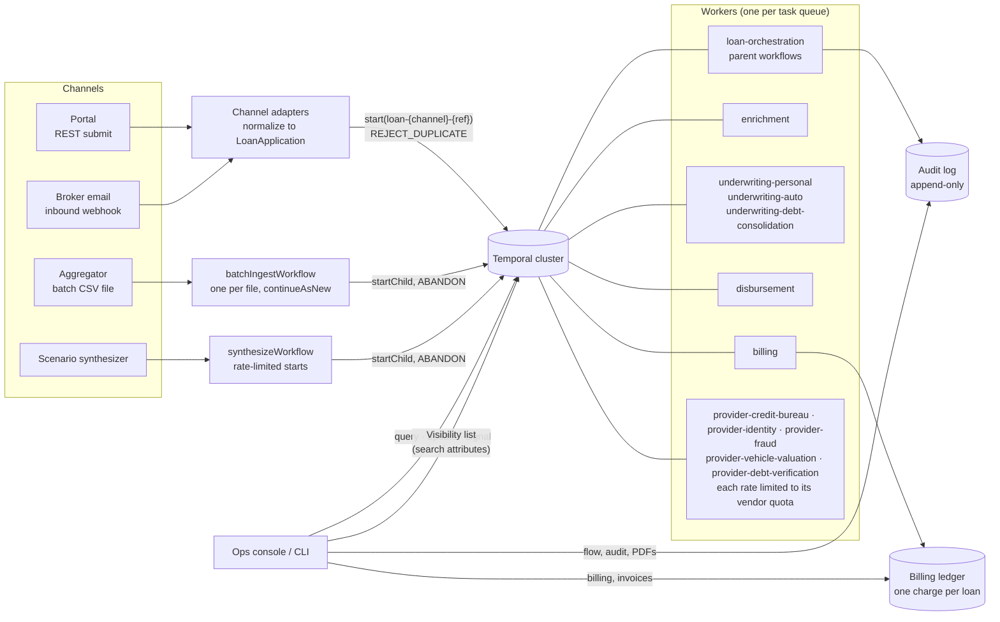
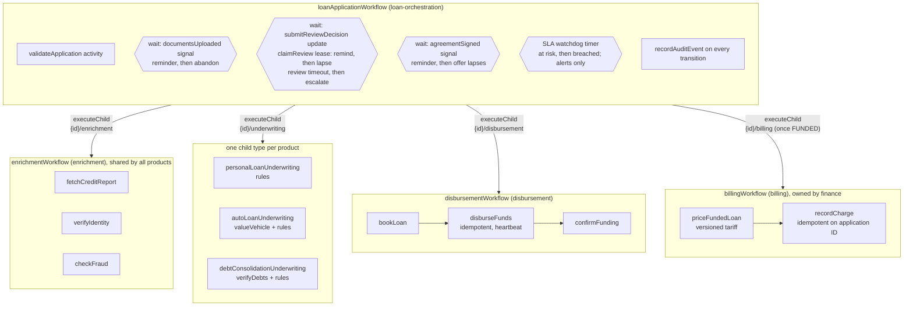
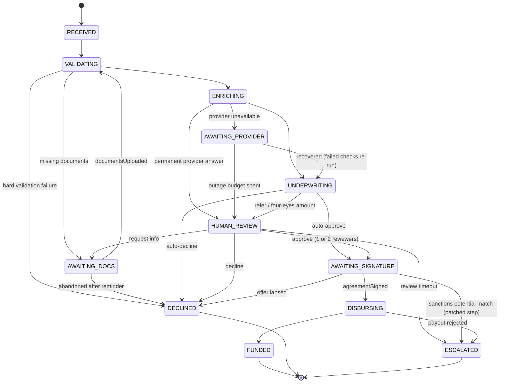
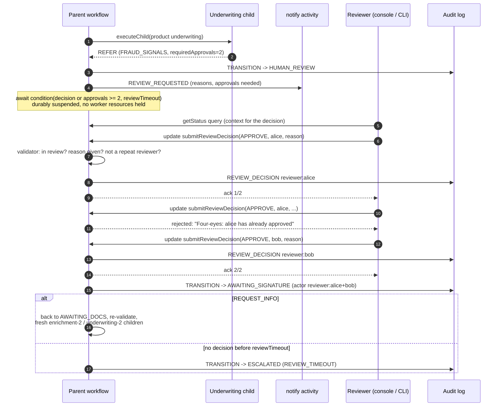
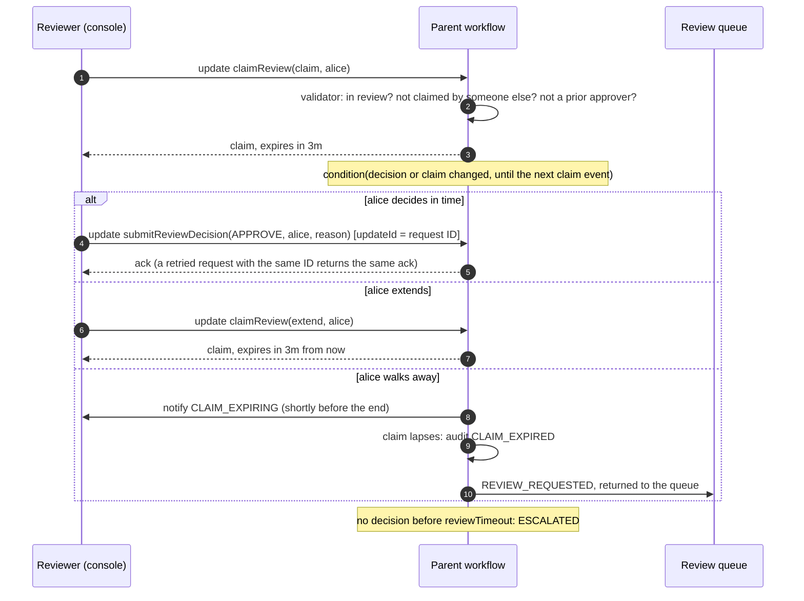
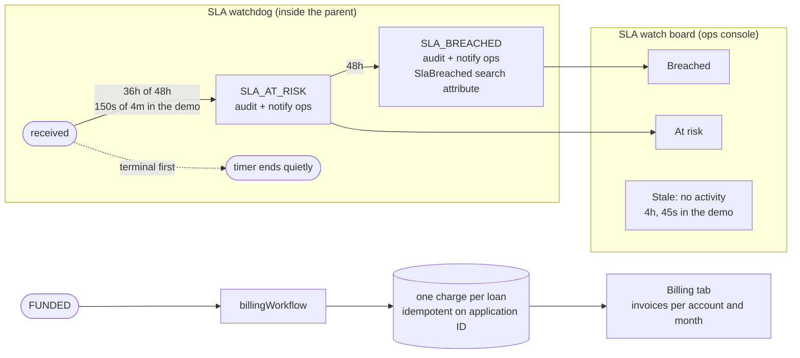
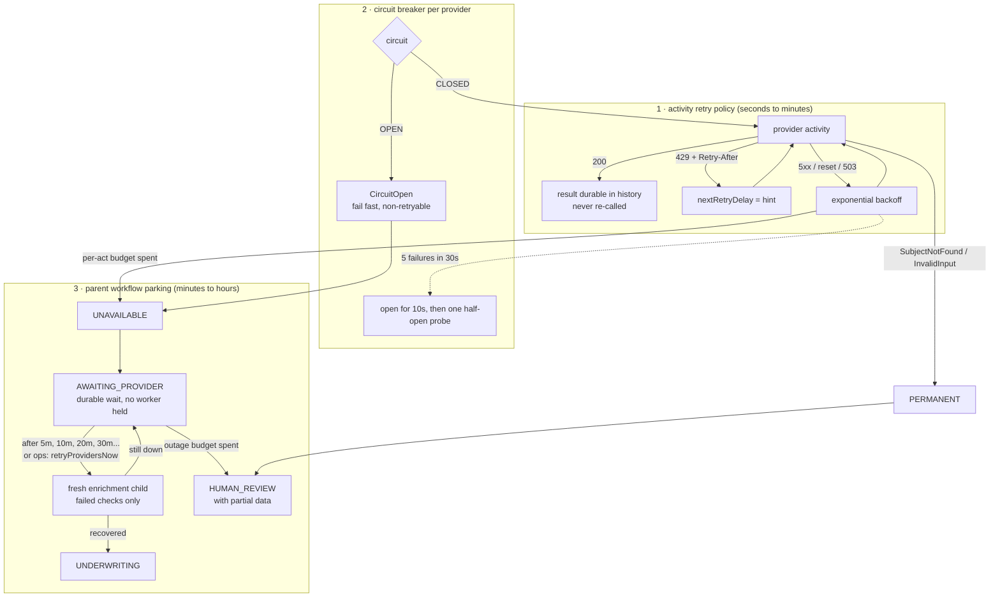
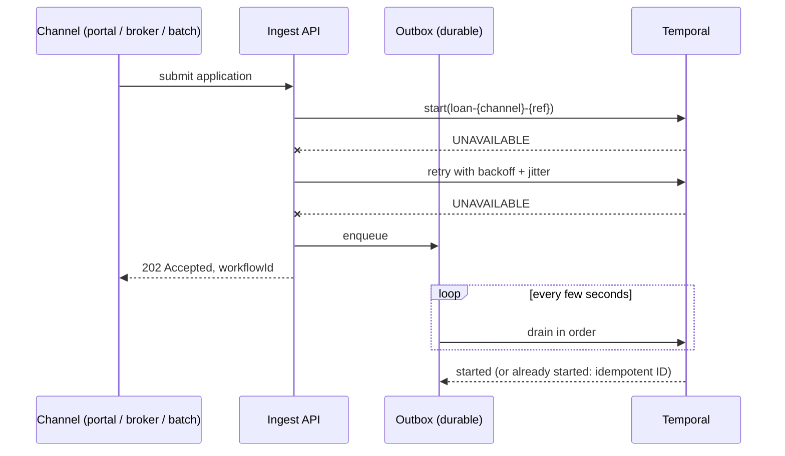
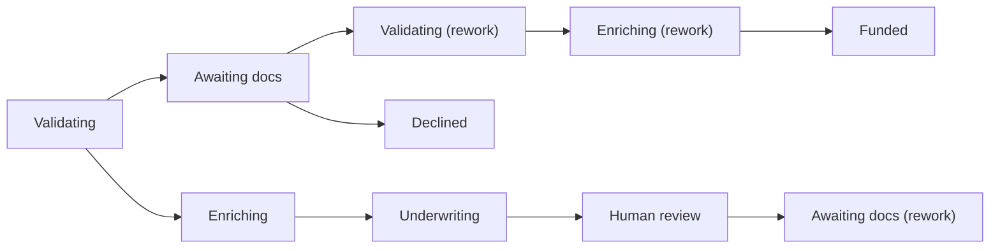

# Diagrams

All diagrams are Mermaid and render on GitHub. The ops console's Flow page draws diagram 3 live, with the number of applications in each state.

## 1. System architecture

## 2. Parent and child workflows

Every interactive wait lives in the parent, so callers only ever address one workflow ID. Children are non-interactive: input in, result out.

## 3. Application lifecycle

Not drawn, to keep it readable:
- **Withdraw** (signal) leads to DECLINED from any wait or stage boundary before DISBURSING.
- **Escaped Temporal failures** (a failed child, or an activity out of retries) lead to ESCALATED from whatever stage they hit, with the root cause as the reason.

## 4. Human in the loop

## 4b. Review claims: a lease, like a web session

A reviewer claims a case before deciding, so two people can't work it at once. The claim is a lease: it lasts a fixed time (30 minutes in production, 3 in the demo), the holder is reminded before it ends, and if nobody extends it, it lapses and the case goes back to the queue. A forgotten browser tab never strands a case. Only the overall review timeout escalates.

## 4c. SLA watch and billing

Each application runs a watchdog timer alongside its lifecycle. It alerts and never cancels: a hard stop at 48 hours could interrupt a payout. A funded loan starts the billing child, which retries until the charge is recorded once.

## 5. Third-party failures and downtime

Core banking follows layer 1 only, with a long budget: the disbursement child retries an idempotent payout for up to 24h before the parent escalates.

## 6. When Temporal itself is unreachable

## 7. Sankey construction (ops console)

The Sankey is built from audit transitions, because Visibility only knows the current state. Loops would make the graph cyclic, so states are keyed by round: every loop returns through VALIDATING, which starts round 2 ("rework"). Later rounds fold into round 2, and terminal states are shared.

